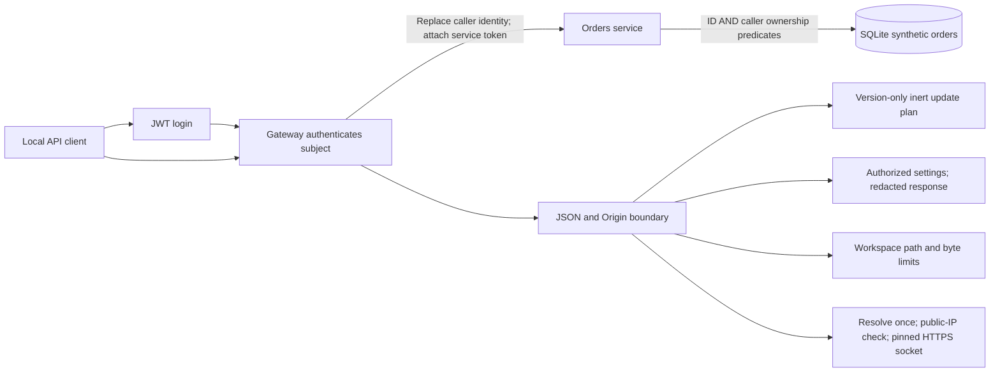

# Gateway Order Authorization

A runnable local security lab for two boundaries: a JWT gateway forwarding requests to an orders service, and a tooling API accepting settings, update requests, and document sources. It shows where authentication ends and resource ownership, request validation, file isolation, and network controls begin.

The two FastAPI applications use synthetic Alice/Bob accounts and three invented orders. The fixed SQL lookup and reorder operations select by both order ID and caller ID. A client-supplied `X-User-Id` cannot override the identity from the signed token. An internal service token also prevents accidental unauthenticated calls to the backend.

The management endpoints demonstrate JSON media-type checks, browser Origin checks, version-only update targets, settings authorization, bounded workspace reads, and public-only HTTPS fetching. Updates return an **inert command plan**; no installer, shell, model CLI, plugin, or model runs. Summaries are bounded text excerpts. Provider settings stay in process memory and responses redact the key.

## Run locally

Requires Python 3.11+. From this directory:

```powershell
python -m venv .venv
.\.venv\Scripts\python.exe -m pip install -r requirements.txt
.\.venv\Scripts\python.exe -B -m unittest discover -s tests -v
```

Start these in two terminals and leave both running:

```powershell
.\.venv\Scripts\python.exe -B -m uvicorn auth_lab.orders:create_app --factory --host 127.0.0.1 --port 8767
```

```powershell
.\.venv\Scripts\python.exe -B -m uvicorn auth_lab.gateway:create_app --factory --host 127.0.0.1 --port 8766
```

Open [gateway API docs](http://127.0.0.1:8766/docs) and [walkthrough](http://127.0.0.1:8766/demo). Use `POST /auth/login` with `{"username":"bob","password":"bob-demo"}`, copy the returned token into the docs' **Authorize** button, then request order 3 and order 1. His own order returns 200; another user's or a missing order returns the same 404. Reordering another user's order also returns 404 and inserts nothing.

Alice's synthetic password is `alice-demo`. A token expires after ten minutes. The example signing and internal-service keys are public demo constants. Keep these servers on loopback; this lab is not a production identity system. Data and settings reset when the processes restart.

## Architecture



## CODE MAP

| File | Responsibility and connections |
|---|---|
| `auth_lab/__init__.py` | Package identity. |
| `auth_lab/auth.py` | Synthetic login, signed JWT creation/validation, and local service identity constants. Used by both HTTP apps. |
| `auth_lab/gateway.py` | Login, native HTTP forwarding, caller-header replacement, JSON/Origin checks, and management routes. Calls the tools and orders service. |
| `auth_lab/orders.py` | Orders HTTP app; validates gateway identity and maps missing or cross-owner resources to one 404 response. |
| `auth_lab/store.py` | SQLite seed, owner-filtered list/get queries, and atomic owner-filtered reorder insert. |
| `auth_lab/tooling.py` | Strict release target validation, inert install plan, workspace confinement, public DNS address checks and pinned HTTPS fetch, bounded excerpts. |
| `examples/workspace/readme.txt` | Synthetic document available to the file-summary tool. |
| `tests/test_boundaries.py` | Native FastAPI/HTTPX integration and independent boundary regression cases, including malformed HTTP upstream responses. |
| `requirements.txt` | FastAPI, Uvicorn, HTTPX and JWT dependencies. |
| `.gitignore` | Excludes environments, caches, generated data and runtime configuration. |

## What the checks establish

Tests exercise the actual apps, JWT library, HTTPX request forwarding, and SQLite predicates. The URL fetcher resolves once, rejects the entire address set if any result is private or special, connects to the selected numeric address, and retains the original hostname for TLS verification. It follows no redirects, accepts no compressed bodies, and limits response bytes. Socket operations use five-second timeouts; a five-second body deadline starts after DNS. Operating-system DNS resolution has no application deadline here. Tests substitute the remote connection, so they establish address selection and failure handling, not real TLS interoperability or resistance to every network attack.

The lab independently recreates described access-boundary examples. It does not reproduce a full tooling dashboard, execute unsafe installation, intentionally expose a vulnerable service, run a security scanner, or change repository protection. A correctly authenticated user still needs ownership checks in every endpoint that reads or copies a resource. Use separate identities, managed secrets, service authentication and deployment-specific network policy in a real system.

Related open-source project and review documentation: [OpenCode](https://github.com/anomalyco/opencode), [FastAPI](https://github.com/fastapi/fastapi), [CodeRabbit security](https://docs.coderabbit.ai/security), [attack surface](https://docs.coderabbit.ai/security/attack-surface).
